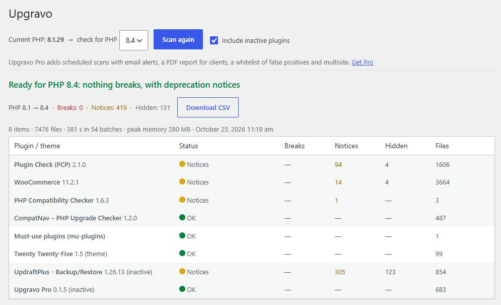
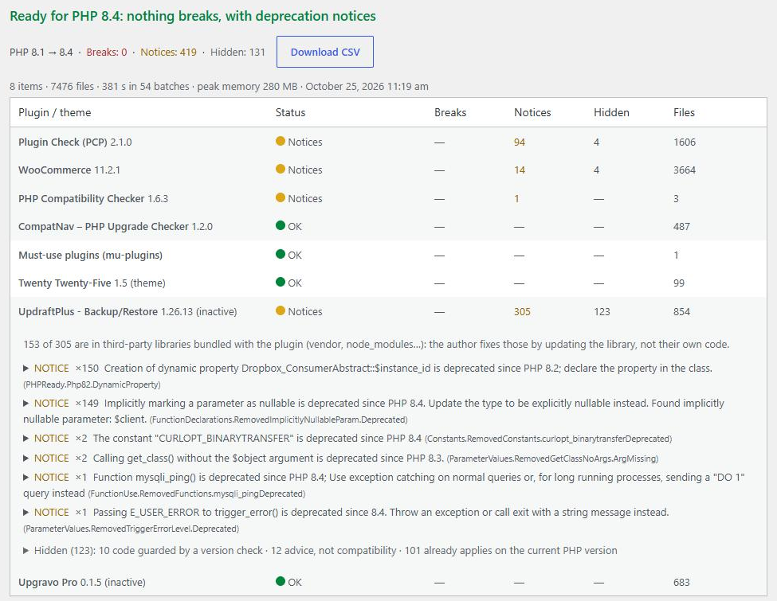
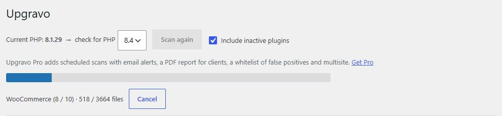
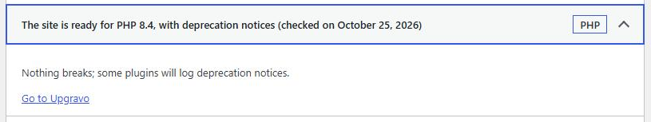

<p align="center"></p>

# Upgravo – PHP Compatibility Check

Scans the plugins and theme of a WordPress site **on its own server** and tells you what will break before you upgrade PHP (8.1, 8.2, 8.3, 8.4). No external service, no `exec()`, no account.

- **Install:** WordPress admin → Plugins → Add New → search for **Upgravo** — or [wordpress.org/plugins/upgravo](https://wordpress.org/plugins/upgravo/)
- **Try it in your browser:** the *Live Preview* button on the WordPress.org page opens it in WordPress Playground.
- **Website:** [phpready.com](https://phpready.com/)
- **Support:** please use the [WordPress.org support forum](https://wordpress.org/support/plugin/upgravo/) (issues are disabled here so every question is answered in one place).

## What it does

- Scans active plugins, the active theme (and parent), must-use plugins and drop-ins in short batches, so it works on shared hosting.
- Gives a verdict and a "What to do first" list: what **breaks**, what only raises **deprecation notices**, and what was **hidden** as a false positive (with the reason).
- Separates third-party libraries bundled inside a plugin from the plugin's own code.
- Exports a CSV, adds the verdict to Tools → Site Health, and includes a WP-CLI command: `wp upgravo scan`.

## Screenshots

| | |
|---|---|
|  |  |
|  |  |

## Building from source

The scanning engine is [PHP_CodeSniffer](https://github.com/PHPCSStandards/PHP_CodeSniffer) + [PHPCompatibility](https://github.com/PHPCompatibility/PHPCompatibility) + [PHPCSUtils](https://github.com/PHPCSStandards/PHPCSUtils), installed with Composer:

```
composer install --no-dev
```

The release package on WordPress.org ships `vendor/` without the parts the scanner never runs (tests, docs and PHP_CodeSniffer's coding-style standards).

## License

GPLv3 or later. Bundled libraries keep their own licenses (BSD-3-Clause for PHP_CodeSniffer, LGPL-3.0-or-later for PHPCompatibility and PHPCSUtils).
